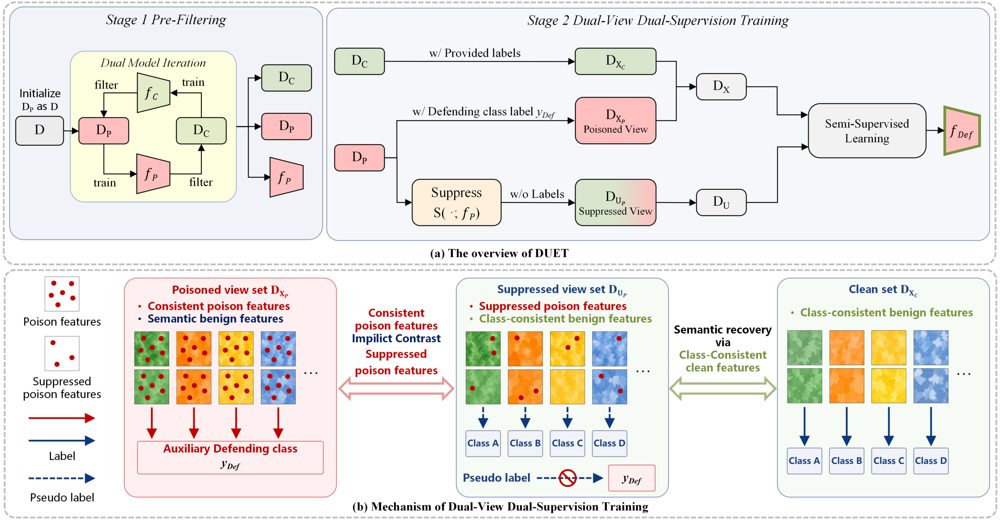

<div align="center">

<h1>DUET</h1>
<h3>Turning Poison into Cure:<br>Dual Use of Poisoned Samples for Backdoor Defense</h3>
<p>Hongrui Yu · Lu Qi · Hailong Sun</p>

<p>
  <a href="#overview">Overview</a> ·
  <a href="#datasets">Datasets</a> ·
  <a href="#quick-start">Quick Start</a> ·
  <a href="#outputs">Outputs</a>
</p>

</div>

## Overview

**DUET** trains an image classifier on potentially poisoned data. It uses the trigger in a suspicious image to teach rejection, while using the same image's semantic content to teach classification.

1. **Pre-Filtering (PF).** Two models take turns scoring samples to partition the training set into trustworthy and suspicious subsets.
2. **Dual-View Dual-Supervision training (DvDs).** Each suspicious image contributes two views. The original receives an auxiliary defending-class label. For the second view, DUET uses Integrated Gradients to locate highly attributed regions and inpaints them. MixMatch treats this view as unlabeled and assigns a pseudo-label over the original semantic classes. Trustworthy images keep their provided labels. A single classifier learns from all three inputs and can predict the defending class to reject an input at inference.



## Datasets

Ready-to-use datasets for all eight attack configurations are available below.

**[Download the attack datasets from Google Drive](https://drive.google.com/drive/folders/1beyGc4D4FDoiny9mAGtNEUqPxVbmhmcr)**

For the example below, download the `badnet` folder and place it under `datasets/` at the repository root. Keep the binary files and their matching `_index.txt` files together.

```text
repository/
├── DUET_code/
│   ├── DUET.py
│   └── config/baseline_duet.yaml
└── datasets/
    └── badnet/
        └── cifar10/    # .bin and _index.txt files
```

## Quick Start

The example trains **PreActResNet18 on CIFAR-10**. The reference environment uses Linux, an NVIDIA GPU, Python 3.10.12, PyTorch 2.7.0 with CUDA, and torchvision 0.22.0.

**1. Install the dependencies.** With CUDA-enabled PyTorch and torchvision installed, run these commands from the repository root. OpenCV provides the inpainting operation.

```bash
cd DUET_code
python -m pip install -r requirements.txt opencv-python
```

**2. Select the attack.** The supplied configuration lists eight attacks. For the single-folder example, set these two fields in `config/baseline_duet.yaml`, keeping the other settings in place.

```yaml
dataset_root: ../datasets
attack_type_list: [badnet]
```

To run all eight attacks, download all attack folders under `datasets/` and keep the full `attack_type_list` in the supplied configuration.

**3. Run DUET.** From the same `DUET_code/` directory, run the training script with the supplied configuration file. The implementation uses target class `0` for the attack.

```bash
python DUET.py --config config/baseline_duet.yaml
```

## Outputs

The default run writes the following files under `DUET_code/record/`.

| File | What to look for |
| :--- | :--- |
| `results.csv` | Read the row with `split_time=semi` for the final clean test accuracy (ACC) and targeted attack success rate (ASR). Both are fractions from 0 to 1. |
| `logs.log` | Configuration and progress for each training stage. |
| `backdoor-defense-model/cifar10/badnet/PreActResNet18/model_ID_semi.pth.tar` | Final classifier weights for the example above. |
